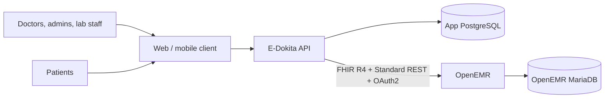
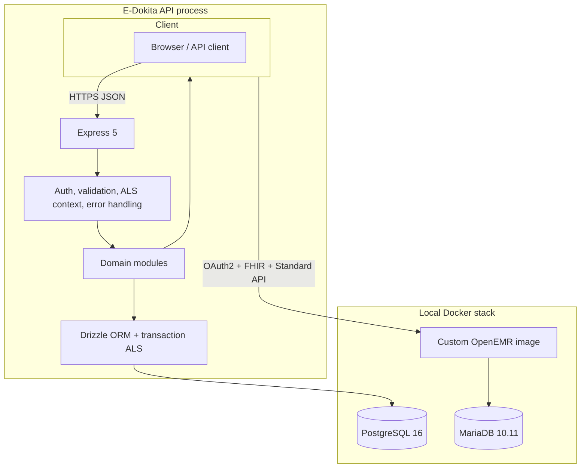
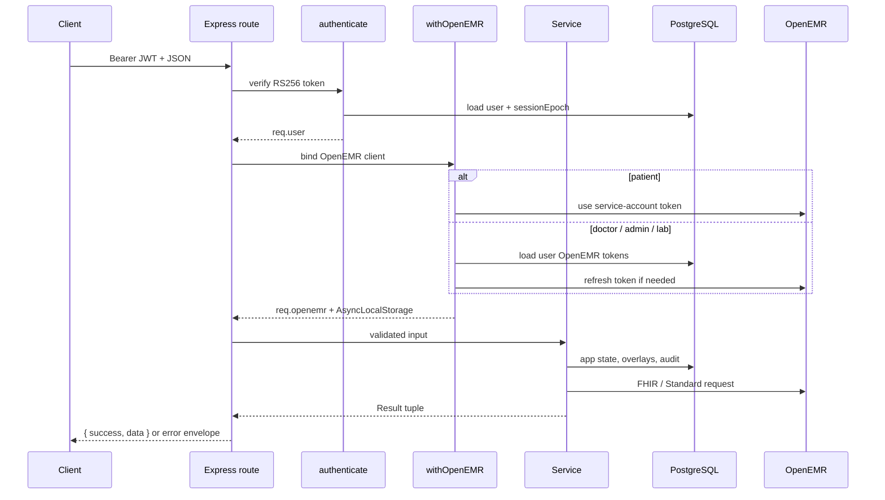
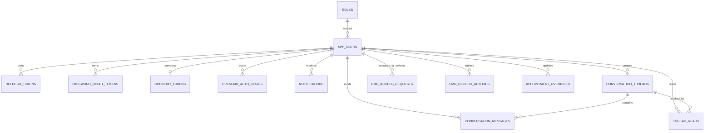

# E-Dokita EMR API

**System architecture and engineering guide**

E-Dokita is a healthcare API gateway and clinical workflow layer built on top of OpenEMR. It gives a modern application a small, typed, role-aware HTTP surface while using OpenEMR as the system of record for clinical data.

The backend is a **modular monolith** written in TypeScript, running on Express 5, with two persistence systems:

- **PostgreSQL** for application identity, sessions, coordination state, messaging, local appointment overlays, and EMR access grants.
- **OpenEMR** (MariaDB + PHP) for patients, practitioners, appointments, encounters, observations, conditions, allergies, medications, prescriptions, labs, and clinical notes.

OpenEMR is reached through its **FHIR R4 API**, its **Standard REST API**, and a small **custom PHP extension** applied at container build time.

---

## 1. System context



### What the API owns

- Application accounts, roles, password hashes, refresh sessions, and password reset tokens.
- OpenEMR OAuth tokens and pending authorization state.
- Per-user OpenEMR account links and encrypted OpenEMR credentials.
- Appointment status/reschedule/note overlays that are not written back upstream.
- Provider working-hours schedules and appointment waitlist entries.
- Messaging threads, messages, read receipts, and in-app notifications.
- EMR access requests and patient-approved, time-limited doctor access.
- EMR record authorship metadata for records created through this API.

### What OpenEMR owns

- The clinical chart and all clinical resources.
- Patient and practitioner master data.
- Appointment source records.
- Encounters, vitals, observations, conditions, allergies, medications, prescriptions, labs, and SOAP notes.
- OpenEMR user accounts and OAuth consent.

### Non-goals

- This repository does not contain the frontend.
- It is not an OpenEMR replacement or a FHIR facade only; it is a workflow layer with its own identity and coordination data.
- It does not provide a full event bus, outbox, analytics warehouse, or real-time messaging transport.

---

## 2. Container and runtime view



### Request lifecycle



---

## 3. Architectural principles

1. **OpenEMR is the clinical source of truth.**
   The app must not invent a second clinical record. Local tables store identity, coordination, and overlays only.

2. **Identity is split deliberately.**
   Application authentication is independent of OpenEMR authentication. A user can exist in the app before or after their OpenEMR link is available.

3. **Contexts are propagated, not passed everywhere.**
   The current OpenEMR client and current database transaction are exposed through `AsyncLocalStorage`. Domain services call `getOpenEMRClient()` and the shared `db` proxy instead of accepting a client/transaction parameter through every layer.

4. **The HTTP boundary is thin.**
   Routes compose authentication, authorization, validation, and context middleware. Controllers translate HTTP to service calls. Services return `[value, error]` result tuples. Helpers contain OpenEMR mapping and persistence detail.

5. **Authorization is explicit and layered.**
   Authentication establishes the caller. Role middleware restricts the endpoint. Resource middleware adds ownership or consent checks. OpenEMR scopes provide a second, upstream boundary.

6. **External state is not assumed to be transactional.**
   PostgreSQL transactions do not cover OpenEMR writes. Cross-system workflows are sequential and must tolerate partial failure.

---

## 4. Repository structure

```text
.
├── app.ts                         # Express composition root and route mounting
├── env.ts                         # Environment validation + derived OpenEMR URLs
├── src/
│   ├── config/
│   │   ├── app/                   # CORS, Helmet, Pino
│   │   ├── auth/                  # JWT, OAuth2 client, PKCE
│   │   ├── db/                    # Drizzle client, ALS transaction proxy, schemas
│   │   ├── openemr-client/        # FHIR/Standard client, token provider, ALS context
│   │   └── swagger/               # OpenAPI document derived from Zod schemas
│   ├── module/                    # Domain modules
│   │   ├── admin/
│   │   ├── appointment/
│   │   ├── auth/
│   │   ├── doctor/
│   │   ├── emr/
│   │   ├── emr-access/
│   │   ├── lab/
│   │   ├── messaging/
│   │   ├── notification/
│   │   ├── openemr/
│   │   ├── patient/
│   │   ├── prescription/
│   │   ├── schedule/
│   │   ├── system/
│   │   ├── user/
│   │   └── waitlist/
│   └── shared/
│       ├── enum/
│       ├── error/
│       ├── middleware/
│       ├── schemas/
│       ├── types/
│       └── utils/
├── drizzle/                       # PostgreSQL migrations + metadata
├── docker/                        # OpenEMR init helpers and MariaDB config
├── openemr/                       # Custom PHP services/controllers + upstream patches
├── docs/                          # Deeper OpenEMR and helper notes
├── Dockerfile                     # Builds the custom OpenEMR image
└── docker-compose.yml             # Local PostgreSQL + MariaDB + OpenEMR stack
```

### Layer responsibilities

| Layer | Responsibility | Examples |
|---|---|---|
| Route | HTTP path, middleware order, roles, validation | `emr.route.ts`, `appointment.route.ts` |
| Controller | Read request, call service, set status code | `emr.controller.ts` |
| Service | Domain orchestration and business rules | `auth.service.ts`, `emr-access.service.ts` |
| Helper | Mapping, persistence helpers, OpenEMR payloads | `appointment/helper.ts`, `emr/helper.ts` |
| Config | External clients and runtime infrastructure | `db.ts`, `client.ts`, `jwt.ts` |
| Shared | Cross-cutting contracts and utilities | `error-handler.ts`, `http.ts`, `fhir-mapper.ts` |

---

## 5. Domain modules

| Module | Responsibility | Primary data |
|---|---|---|
| Auth | Registration, login, refresh, logout, password reset, OpenEMR OAuth | App users, refresh tokens, OpenEMR tokens/state |
| User | Current-user profile and account links | `app_users` |
| Admin | Dashboard counts, OpenEMR users, facilities | OpenEMR |
| Doctor | Practitioner CRUD and connected patients | OpenEMR Practitioner |
| Patient | Patient CRUD, demographics, linked patient profile | OpenEMR Patient |
| Appointment | Booking, slots, categories, status transitions, reschedule overlay | OpenEMR Appointment + local overrides |
| Schedule | Per-provider working hours and slot duration | `provider_schedules` |
| EMR | Clinical summary, encounters, vitals, observations, conditions, allergies, medications, SOAP notes | OpenEMR + authorship metadata |
| EMR Access | Doctor request → patient approval → time-limited chart access | `emr_access_requests` |
| Lab | Lab orders/results, lab role, doctor notification | OpenEMR lab API + notifications |
| Prescription | Prescription list/create/delete | OpenEMR Standard API |
| Waitlist | Earlier-appointment requests | `appointment_waitlist` |
| Messaging | Patient/staff conversations and read state | `conversation_*`, `thread_reads` |
| Notification | In-app notifications and unread state | `notifications` |
| OpenEMR | OAuth connection lifecycle and provisioning | OpenEMR OAuth + app links |
| System | OpenEMR version and capability statement | OpenEMR |

---

## 6. Authentication and authorization

### 6.1 Application identity

- Passwords are hashed with **Argon2id** (`@node-rs/argon2`, 64 MiB, 3 iterations).
- Access tokens are **RS256 JWTs** signed by the API, issuer `e-dokita`, audience `e-dokita-api`.
- Access-token lifetime is **15 minutes**.
- Refresh tokens are opaque, stored as SHA-256 hashes, valid for **30 days**, and revoked on rotation/logout.
- A refresh session is rejected if more than **3 days** have passed since its last rotation.
- `session_epoch` on the user invalidates all previously issued access tokens after password change/logout.
- Password reset tokens are single-use, hashed, and valid for **1 hour**.

Signing keys come from:

- `APP_JWT_PRIVATE_KEY` / `APP_JWT_PUBLIC_KEY`, or
- `private-key.pem` / `public-key.pem` at the repo root.

### 6.2 Roles

| Role | Purpose | OpenEMR token behavior |
|---|---|---|
| `patient` | Patient self-service | Shared service account; app enforces ownership |
| `doctor` | Clinical work | Per-user OpenEMR OAuth token |
| `admin` | Administration and full EMR access | Per-user OpenEMR OAuth token |
| `lab` | Lab order/result workflow | Per-user OpenEMR OAuth token |

The role is an application concept. It is mapped to OpenEMR scopes when a user connects or is provisioned.

### 6.3 Request authorization stack

```text
authenticate
  → validate auth user shape
  → withOpenEMR / service account
  → requireRole(...)
  → validate(input schema)
  → path/resource guards
  → controller
```

- `authenticate` verifies the JWT, reloads the user, and checks `sessionEpoch`.
- `withOpenEMR` binds the right OpenEMR client into `req.openemr` and AsyncLocalStorage.
- `requireRole` handles coarse-grained role checks.
- `requireEmrAccess` handles patient ownership, admin bypass, and doctor consent.
- `requirePatientScope` resolves the patient id from the caller or input for patient-scoped workflows.

### 6.4 EMR access consent

All `/:patientId` EMR routes pass through `requireEmrAccess`:

- **Admin:** bypass.
- **Patient:** may access only their own `openemr.patientId`.
- **Doctor:** must have an approved, unexpired access request for that patient.
- **Lab:** forbidden from EMR chart routes.

Doctor request flow:

1. Doctor calls `POST /api/emr-access/:patientId/requests`.
2. Duplicate pending/active requests are reused.
3. Patient calls `GET /api/emr-access/requests`.
4. Patient calls `PATCH /api/emr-access/requests/:requestId` with `approved` or `denied`.
5. Approval sets `expiresAt = now + EMR_ACCESS_TTL_HOURS` (default 24 hours).
6. `requireEmrAccess` checks the approved/unexpired grant on every request.

This is application-level consent. It does not create a separate OpenEMR token scope.

---

## 7. OpenEMR integration

### 7.1 Two upstream APIs

| API | Base | Used for |
|---|---|---|
| FHIR R4 | `<OPENEMR_URL>/apis/default/fhir` | Patient/Practitioner reads, appointments, encounters, clinical resources |
| Standard REST | `<OPENEMR_URL>/apis/default` | OpenEMR user/facility lists, appointments, encounters, vitals, prescriptions, labs, observations |

`OpenEMRClient` exposes typed helpers:

- `fhirRead`, `fhirSearch`, `fhirCreate`, `fhirUpdate`, `fhirGet`, `fhirPost`
- `standardGet`, `standardPost`, `standardPut`, `standardDelete`

Standard API responses are normalized from `{ data: [...] }` envelopes. Standard write responses can return HTTP 200 with validation errors; the client detects and throws those as application errors.

### 7.2 Authentication modes

**Per-user Authorization Code + PKCE + OIDC** is used for staff:

- `GET /api/openemr/authorize` creates state/nonce/PKCE verifier with a 10-minute TTL.
- OpenEMR redirects to `/api/openemr/callback`.
- The callback exchanges the code, stores tokens, and links `sub` / `fhirUser` to the app user.
- Refresh uses the stored refresh token and never echoes a narrowed `scope` back to OpenEMR.
- A 401 from OpenEMR triggers one forced token refresh attempt.
- Stored OpenEMR refresh links default to a **90-day** expiry when OpenEMR does not return one.

**Password grant** is used by the service account:

- Provisioning, system/admin operations, and patient-facing routes.
- Token is cached per process with a 60-second expiry skew.
- Patient routes use this token because OpenEMR patient-context writes are not supported in this setup.

**Credential auto-connect** is used for staff:

- Doctor and lab OpenEMR logins are created during registration with a generated password.
- The password is stored encrypted in PostgreSQL.
- Login attempts to reuse a valid token, refresh it, or fall back to the stored credentials.

### 7.3 Provisioning

| App role | OpenEMR provisioning |
|---|---|
| `doctor` | Create OpenEMR login, resolve user by email, store `practitionerId`, store encrypted credentials |
| `lab` | Create OpenEMR login in the clinical group, resolve user, store credentials |
| `patient` | Create a FHIR Patient, store `patientId` (UUID) and `patientPid` (numeric id) |
| `admin` | Create an OpenEMR administrator login; failures do not block registration |

Registration creates the OpenEMR identity first, then the app user and session. This is a cross-system workflow with no distributed transaction.

### 7.4 Custom OpenEMR extension

The local OpenEMR image is built from a digest-pinned upstream image plus:

- New PHP files for lab and clinical observation endpoints.
- Patches against upstream route registration and scope registration.

```text
openemr/src/Services/LabService.php
openemr/src/RestControllers/LabRestController.php
openemr/src/Services/ClinicalObservationService.php
openemr/src/RestControllers/ObservationRestController.php
openemr/patches/0001-add-standard-api-routes.patch
openemr/patches/0002-register-api-scopes.patch
```

`docker/openemr-init.sh` idempotently adds the required lab/observation scopes to the registered OAuth client. Run `npm run openemr:scopes` after the client exists.

> See `docs/OPENEMR.md` for deeper OpenEMR setup and troubleshooting notes.

---

## 8. Data architecture

### 8.1 Ownership matrix

| Concern | System | Notes |
|---|---|---|
| App users, roles, passwords | PostgreSQL | `app_users`, `roles` |
| App refresh/reset tokens | PostgreSQL | Hashed opaque tokens |
| OpenEMR links and OAuth tokens | PostgreSQL | `openemr_*` tables/columns |
| Patient/practitioner clinical master | OpenEMR | UUID is the public identifier |
| Appointments | OpenEMR + PostgreSQL | Upstream source + local status/time overrides |
| Working hours | PostgreSQL | Provider schedules drive slot generation |
| EMR consent | PostgreSQL | Approved grants expire after TTL |
| Clinical record authorship | PostgreSQL | `emr_record_authors` |
| Messaging and notifications | PostgreSQL | App-local |
| Lab orders/results | OpenEMR | Custom lab Standard API |

### 8.2 PostgreSQL entity overview



Additional tables without direct user FKs:

- `provider_schedules`: provider UUID + weekday + working window + slot size.
- `appointment_waitlist`: patient UUID + optional practitioner/date/reason.
- `appointment_overrides`: appointment UUID + local status/start/end/note.

### 8.3 Identifier strategy

- OpenEMR **UUID** is the public clinical identifier.
- OpenEMR numeric **pid** is retained where the Standard API requires it (for example appointments and some encounter/vital paths).
- Some historical users may not have `openemr_patient_pid`; code generally falls back to the UUID, but that may not satisfy every upstream endpoint.

### 8.4 Migrations

- Drizzle PostgreSQL migrations live in `drizzle/`.
- Apply with `npm run db:migrate`.
- The journal includes migrations through `0011_emr_access_requests`.
- Snapshot metadata is not present for every historical migration; treat the SQL files as the source of truth when debugging migration history.

---

## 9. Key workflows

### 9.1 Registration and login

```text
POST /api/auth/register
  → reject duplicate email
  → provision OpenEMR identity
  → hash password
  → create app user
  → issue access JWT + refresh token

POST /api/auth/login
  → verify Argon2 password
  → opportunistically connect/refresh OpenEMR
  → issue fresh session
```

### 9.2 Appointment lifecycle

```mermaid
stateDiagram-v2
  [*] --> pending: patient books
  pending --> awaiting-payment: doctor/admin accepts
  awaiting-payment --> booked: doctor/admin confirms payment
  booked --> rescheduled: reschedule
  rescheduled --> rescheduled: reschedule again
  booked --> fulfilled: done after start
  rescheduled --> fulfilled: done after start
  pending --> cancelled
  awaiting-payment --> cancelled
  booked --> cancelled
  booked --> noshow
```

- Appointment creation writes the source appointment to OpenEMR.
- Status transitions, reschedules, and notes are stored in `appointment_overrides`.
- List/detail reads merge the OpenEMR appointment with the local override.
- Slots are computed from `provider_schedules`, default working hours, and booked appointment windows.
- Deleting an appointment removes it upstream and drops the local override.
- Upstream and local appointment state can diverge if OpenEMR is edited directly.

### 9.3 EMR access

```text
Doctor → request access ──→ pending
Patient → approve/deny ───→ approved/denied
Approved → expiresAt = now + TTL
Doctor → requireEmrAccess → EMR routes
```

### 9.4 Lab workflow

```text
Doctor creates order
  → OpenEMR lab_order
  → app records author
  → lab/admin records result
  → app records result authors
  → app finds ordering doctor
  → in-app notification
  → patient/staff read results with role scoping
```

### 9.5 Messaging and notifications

- Conversations are app-local and link a patient and/or practitioner.
- Access is limited to the creator, the linked patient, the linked practitioner, or admin.
- Sending a message writes the message and thread timestamp in one PostgreSQL transaction.
- Recipients are notified in-app after commit.
- Notifications are best-effort: delivery failure is logged and does not fail the source operation.
- No WebSocket/push transport is included; clients poll the notification endpoints.

---

## 10. API conventions

### 10.1 Response shape

Success:

```json
{
  "success": true,
  "data": {}
}
```

Error:

```json
{
  "success": false,
  "error": {
    "message": "Human-readable message",
    "code": "ERROR_CODE",
    "status": 400,
    "details": {}
  }
}
```

Validation errors return **422** with field-level details.

### 10.2 Internal result pattern

Services return:

```ts
type Result<T, U = Error> = [T | null, null | U];
```

The success value and error are mutually exclusive. Controllers unwrap the tuple and throw the error; `AsyncHandler` forwards rejected promises to the central error handler.

### 10.3 API surface

| Prefix | Purpose | Typical roles |
|---|---|---|
| `/` / `/health` | Service metadata and liveness probe | Public |
| `/api/system` | OpenEMR version and FHIR capability | Public |
| `/api/auth` | Register, login, refresh, logout, password reset | Public + authenticated |
| `/api/users` | Current profile and profile update | Authenticated |
| `/api/admin` | Stats, users, facilities | Admin |
| `/api/doctors` | Practitioner directory and CRUD | Admin, patient, doctor |
| `/api/patients` | Patient directory and CRUD | Admin, doctor, patient |
| `/api/appointments` | Booking, slots, categories, status workflow | Admin, doctor, patient |
| `/api/schedules` | Provider working hours | Admin, doctor, patient (read) |
| `/api/emr` | Clinical chart and writes | Admin, doctor, patient + consent |
| `/api/emr-access` | Doctor access requests and patient review | Doctor, patient |
| `/api/lab` | Lab orders and results | Admin, doctor, lab, patient |
| `/api/prescriptions` | Prescription workflow | Admin, doctor, patient |
| `/api/waitlist` | Earlier-appointment requests | Admin, doctor, patient |
| `/api/conversations` | Patient/staff messaging | All authenticated roles |
| `/api/notifications` | In-app notifications | All authenticated roles |
| `/api/openemr` | OpenEMR OAuth connection | Authenticated staff |

Interactive documentation is served at:

- `GET /api/docs` — Swagger UI
- `GET /api/docs.json` — OpenAPI JSON

The OpenAPI document is generated from the same Zod schemas used for request validation.

---

## 11. Transactions and consistency

### 11.1 PostgreSQL transaction context

`src/config/db/db.ts` exports a `db` proxy. When an AsyncLocalStorage transaction exists, property access is routed to the transaction object; otherwise it goes to the base pool.

```text
withTransaction(fn)
  → reuse existing transaction if present
  → otherwise open one and run fn inside ALS
```

`@Transactional()` is applied only to **DB-only private methods**:

- Auth: registered-user creation, session rotation, password changes, password reset, logout.
- Messaging: message persistence.
- OpenEMR: token/connection persistence.
- Schedule: schedule replacement.

Public methods keep their `Result` error contract; private decorated methods throw so the transaction rolls back.

### 11.2 Consistency boundaries

There is **no distributed transaction** across PostgreSQL and OpenEMR. Consequences:

- OpenEMR provisioning can succeed while app-user creation fails.
- OpenEMR clinical writes can succeed while local authorship/overlay writes fail.
- Local appointment status can differ from OpenEMR.
- Notifications are best-effort and not part of the source transaction.

There is currently no outbox, saga coordinator, or compensation job. Any workflow that spans systems must be designed with idempotency and reconciliation in mind.

---

## 12. Security model

### Controls present

- Argon2id password hashing.
- Short-lived RS256 access tokens.
- Hashed refresh tokens with rotation and revocation.
- `sessionEpoch` invalidation.
- Hashed, single-use password reset tokens.
- OpenEMR credentials encrypted at rest with JWE (`A256GCM`), key derived from `TOKEN_ENCRYPTION_KEY` or JWT private key.
- Role and resource authorization middleware.
- Patient-approved EMR access with expiry.
- Zod validation at the HTTP boundary.
- Helmet security headers and configurable CORS.
- Centralized error handling that avoids leaking internal errors.

### Security boundaries and cautions

- **OpenEMR tokens are stored as plaintext** in `openemr_tokens`; only the stored OpenEMR password is encrypted.
- **Patient access is enforced in application code**, not by a patient-scoped OpenEMR token. The service account is broad, so any authorization bug is high impact.
- **Admin bypasses EMR consent** by design.
- **Doctor EMR access is application-level consent**, not a reduced OpenEMR scope.
- The API assumes it is the only client of the OpenEMR instance. Network-level access to OpenEMR must be restricted.
- There is no rate limiting, account lockout, MFA, or anomaly detection in this repository.
- Key rotation is manual. `private-key.pem` and `public-key.pem` are not committed.

---

## 13. Configuration

Environment is validated by Zod in `env.ts`. `APP_STAGE` selects the env file:

- `dev` → `.env.dev`, falling back to `.env`
- `test` → `.env.test`
- `prod` → `.env.prod`

### Required or important variables

| Variable | Purpose |
|---|---|
| `VERSION` | API/OpenAPI version |
| `APP_STAGE` | `dev`, `test`, or `prod` |
| `PORT` | HTTP port |
| `LOCAL_URL` | Public base URL used in docs/logging |
| `CORS_ORIGIN` | Comma-separated origins; `*` allows all |
| `LOG_LEVEL` | Pino log level |
| `DATABASE_URL` | PostgreSQL connection string |
| `OPENEMR_URL` | OpenEMR site root; all API/OAuth URLs derive from it |
| `OPENEMR_CLIENT_ID` | Registered OAuth client id |
| `OPENEMR_CLIENT_SECRET` | OAuth client secret |
| `OPENEMR_USERNAME` / `OPENEMR_PASSWORD` | Service-account credentials |
| `OPENEMR_ACCESS_TOKEN` | Optional seeded service token |
| `OPENEMR_REDIRECT_URI` | Must exactly match the registered callback |
| `FRONTEND_URL` | OAuth callback redirect target |
| `OPENEMR_DEFAULT_APPOINTMENT_CATEGORY` | Default visit category |
| `OPENEMR_DEFAULT_FACILITY` | Default facility id |
| `OPENEMR_DEFAULT_BILLING_LOCATION` | Default billing location |
| `OPENEMR_WORKING_HOURS_START` / `_END` | Fallback provider working hours |
| `EMR_ACCESS_TTL_HOURS` | EMR consent lifetime; default `24` |
| `APP_JWT_PRIVATE_KEY` / `APP_JWT_PUBLIC_KEY` | Optional inline PEM keys |
| `TOKEN_ENCRYPTION_KEY` | Secret material for credential encryption |

### Local Docker credentials

`docker-compose.yml` also requires:

- `POSTGRES_PASSWORD`
- `MYSQL_ROOT_PASSWORD`
- `MYSQL_PASSWORD`

---

## 14. Running locally

### Prerequisites

- Node.js 20+ (Node 22 recommended; the TypeScript config extends `@tsconfig/node22`)
- npm
- Docker Desktop / Docker Compose

### Setup

```bash
cp .env.example .env
# Fill in database passwords, OpenEMR credentials, OAuth client secret,
# and JWT/encryption key material.

npm install
docker compose up -d
npm run db:migrate
npm run dev
```

The API starts on `http://localhost:8000`. Swagger is at `http://localhost:8000/api/docs`.

### OpenEMR setup

1. Wait for OpenEMR at `http://localhost:8400`.
2. Register an OAuth client in **Administration → System → API Clients**.
3. Set its redirect URI to `OPENEMR_REDIRECT_URI`.
4. Register the required FHIR/Standard/lab/observation scopes.
5. Copy the client id/secret into `.env`.
6. Run:

```bash
npm run openemr:scopes
npm run provision
```

`npm run provision` applies PostgreSQL migrations and reconciles the OpenEMR OAuth client scope ceiling.

### JWT keys

If not supplied through env vars, place a matching RSA keypair at the repo root:

```bash
openssl genpkey -algorithm RSA -pkeyopt rsa_keygen_bits:2048 -out private-key.pem
openssl rsa -pubout -in private-key.pem -out public-key.pem
```

Both files are ignored by Git and excluded from the Docker build context.

---

## 15. Build and deployment

```bash
npm run typecheck
npm run build
npm start
```

`npm run build` bundles `app.ts` to `dist/app.js` with esbuild. External packages remain external, so production installs must include runtime dependencies.

### Deployment checklist

- Provision PostgreSQL and run `npm run db:migrate`.
- Provide all required environment variables.
- Mount or inject the JWT keypair.
- Deploy the custom OpenEMR image or point `OPENEMR_URL` at an equivalent instance.
- Register the OAuth client and run `npm run openemr:scopes`.
- Put the API behind TLS and restrict direct network access to OpenEMR/MariaDB.
- Configure CORS for the deployed frontend origins.
- Configure or disable Swagger exposure for the target environment.

### OpenEMR image upgrades

The OpenEMR overlay is published locally as `e-dokita/openemr:8.4.1-lab` and pinned to a specific upstream digest. To upgrade:

1. Update the digest in `Dockerfile`.
2. Run `openemr/regenerate-patches.sh`.
3. Resolve any failed hunks.
4. Rebuild `docker compose build openemr`.
5. Re-test lab/observation routes and OAuth scopes.

---

## 16. Quality and operations

### Commands

| Command | Purpose |
|---|---|
| `npm run dev` | Watch-mode API |
| `npm run typecheck` | TypeScript check |
| `npm run build` | Bundle to `dist/app.js` |
| `npm start` | Run the bundle |
| `npm run db:generate` | Generate Drizzle migration |
| `npm run db:migrate` | Apply migrations |
| `npm run db:push` | Push schema directly (development only) |
| `npm run db:studio` | Drizzle Studio |
| `npm run openemr:scopes` | Reconcile OpenEMR OAuth scopes |
| `npm run provision` | Migrate + reconcile scopes |

Useful verification sequence:

```bash
npm run typecheck
npx tsc --noEmit --noUnusedLocals --noUnusedParameters
npm run build
npx --yes knip
```

### Observability

- Pino structured application logs.
- `pino-http` request logging.
- Central error handler logs method, path, user id, and role.
- No metrics endpoint, distributed tracing, or alerting is included.

### Automated tests

There is currently no test suite or CI configuration in this repository. Changes are validated with typechecking, bundling, and manual API checks.

---

## 17. Known risks and technical debt

| Risk | Impact | Current state |
|---|---|---|
| No automated tests | Regressions are easy to miss | Typecheck/build/knip only |
| Dual-write workflows | OpenEMR and PostgreSQL can diverge | No outbox or compensation |
| Appointment overlays | OpenEMR UI may not reflect app status/reschedule | Local override table |
| Plaintext OpenEMR tokens | Token database compromise exposes upstream access | Access/refresh tokens unencrypted |
| Broad service account | Patient authorization bugs are high impact | App-level patient scoping |
| No rate limiting/lockout/MFA | Brute-force and abuse exposure | Not implemented |
| CORS omits `PATCH` | Browser preflight can fail for PATCH endpoints | `cors.ts` allows GET/POST/PUT/DELETE |
| OpenEMR admin form scraping | Fragile across OpenEMR upgrades | `admin-ui.ts` uses HTML forms/CSRF |
| Upstream HTML/route changes | Custom patches may fail on upgrade | Manual regeneration required |
| No explicit upstream timeout | A slow OpenEMR can hold requests open | Node `fetch` without timeout |
| Best-effort notifications | Lost notifications on failure | Errors logged, not retried |
| Timezone-sensitive scheduling | Different server time zones change slots | Uses server local time |
| Incomplete migration snapshots | Schema drift harder to diagnose | SQL history is authoritative |

---

## 18. Extending the system

When adding a domain module:

1. Add or update Drizzle schema and migration.
2. Add Zod request/query/param schemas.
3. Implement a service returning `Result<T>`.
4. Keep OpenEMR access through `getOpenEMRClient()`.
5. Add a thin controller using `AsyncHandler`.
6. Add a router with `authenticate`, validation, role guards, and `withOpenEMR` when needed.
7. Mount the router in `app.ts`.
8. Add Swagger paths and request schemas.
9. Run typecheck, noUnused checks, build, and knip.

Rules to preserve:

- Do not call OpenEMR directly from controllers.
- Do not pass the OpenEMR client through service signatures; bind it into request context.
- Do not wrap network calls in PostgreSQL transactions.
- Use `@Transactional()` only on DB-only methods that throw on failure.
- Keep patient ownership and EMR consent checks at the route/middleware boundary.
- Keep response envelopes and error codes consistent.

---

## 19. Glossary

| Term | Meaning |
|---|---|
| **OpenEMR** | External clinical system of record |
| **FHIR R4** | Standard clinical resource API used for reads and several writes |
| **Standard API** | OpenEMR's non-FHIR REST API used for appointments, encounters, vitals, prescriptions, labs |
| **UUID** | Public clinical identifier used in app routes |
| **pid** | Numeric OpenEMR patient id required by some Standard API endpoints |
| **EMR consent** | Patient-approved, time-limited doctor access grant |
| **Overlay** | Local PostgreSQL record merged over an upstream OpenEMR record |
| **Result tuple** | Internal `[value, error]` contract used by services |
| **ALS** | `AsyncLocalStorage`, used for OpenEMR client and DB transaction context |

---

## 20. Related documentation

- `docs/OPENEMR.md` — OpenEMR setup, OAuth behavior, scopes, and integration gotchas.
- `docs/CUSTOM_HELPERS.md` — history of custom helpers replaced by external packages.
- `src/config/swagger/swagger.ts` — generated OpenAPI route documentation.
- `app.ts` — authoritative route mounting.
- `src/config/db/schema/` — authoritative PostgreSQL schema.
